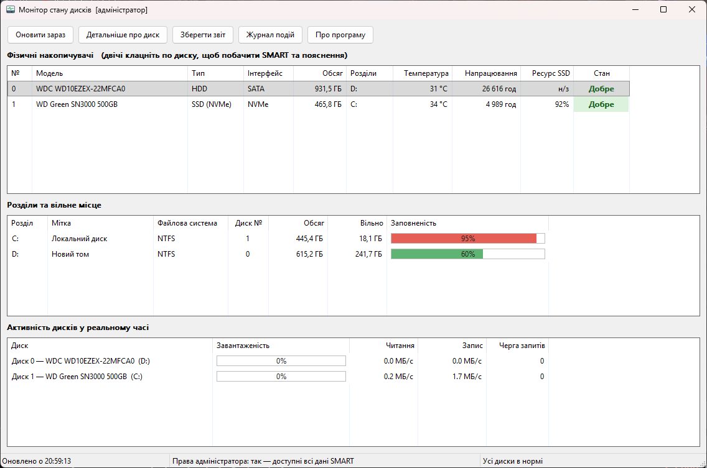

# Монітор стану дисків (DiskMonitor)


[](https://github.com/s1xen7ag/DiskMonitor/releases/latest)

Програма для Windows, яка стежить за станом жорстких дисків (HDD) і твердотільних накопичувачів (SSD). Вона показує температуру, напрацювання, знос SSD, SMART-атрибути, заповненість розділів і активність дисків у реальному часі, а також попереджає, коли з диском щось не так.

Програма **лише читає** інформацію і нічого не записує на диски.

### [Завантажити інсталятор](https://github.com/s1xen7ag/DiskMonitor/releases/latest)



## Можливості

- **Фізичні диски:** модель, тип (HDD, SSD, SSD NVMe), інтерфейс, обсяг, температура, напрацювання, залишковий ресурс SSD.
- **Висновок про стан** кожного диска — «Добре», «Увага» або «Погано» — з поясненням, чому зроблено такий висновок.
- **SMART-атрибути** для SATA-дисків і **журнал стану NVMe** для NVMe-накопичувачів.
- **Розділи та вільне місце** з попередженням, коли місця залишається менше 10 %.
- **Активність дисків у реальному часі:** завантаженість, швидкість читання і запису, черга запитів.
- **Робота у фоні:** програма згортається в трей, раз на хвилину перевіряє диски і показує сповіщення, якщо стан погіршився.
- **Журнал подій** і **текстовий звіт** про всі диски.

## Встановлення

1. Завантажте `DiskMonitor_Setup_1.0.exe` зі сторінки [Releases](https://github.com/s1xen7ag/DiskMonitor/releases/latest).
2. Запустіть інсталятор. Якщо Windows покаже вікно «Windows захистила ваш ПК», натисніть **«Докладніше» → «Виконати в будь-якому разі»**. Так буває з будь-якою програмою без платного цифрового підпису.
3. За бажанням позначте **«Запускати програму автоматично при старті Windows»** — тоді програма постійно стежитиме за дисками з трею.

**Системні вимоги:** Windows 10 або 11 (64-розрядна). Встановлювати додаткові бібліотеки не потрібно.

## Як користуватися

- **Верхня таблиця** — фізичні диски. Колонка «Стан» підсвічується кольором: зелений — «Добре», жовтий — «Увага», червоний — «Погано».
- **Подвійний клік по диску** (або кнопка «Детальніше про диск») відкриває вікно з усіма показниками, поясненням висновку і таблицею SMART-атрибутів або журналом NVMe.
- **Середня таблиця** — розділи (C:, D: …) і заповненість.
- **Нижня таблиця** — активність дисків, оновлюється кожні 2 секунди.
- **«Зберегти звіт»** — текстовий звіт про всі диски.
- **«Журнал подій»** — історія змін стану дисків (`%LOCALAPPDATA%\DiskMonitor\events.log`).
- **Хрестик** згортає програму в трей. Повністю закрити: права кнопка миші на значку → «Вихід».
- Колонка **«Ресурс SSD»** для HDD показує «н/з» (не застосовується): у жорстких дисках немає лічильника ресурсу, їхній стан оцінюється за секторами, температурою і SMART.

### Права адміністратора

Без прав адміністратора Windows не дає прочитати SMART, температуру, напрацювання і знос. Тому під час запуску програма сама просить ці права (вікно UAC). Якщо відмовитися, вона працює з обмеженим набором даних, а права можна отримати пізніше кнопкою «Перезапустити як адміністратор».

Автозапуск створюється як завдання Планувальника завдань Windows з найвищими правами, тому під час входу в систему програма отримує повні дані без вікна UAC. Перевірити: Win + R → `taskschd.msc` → завдання **DiskMonitorKursova**.

## Як визначається стан диска

| Висновок | Умови |
|---|---|
| **Погано** | NVMe: критичне попередження контролера (мало резерву, знижена надійність, режим «лише читання»); SMART прогнозує відмову; Windows позначила диск як несправний; критичний (pre-failure) атрибут SMART опустився до порогу; ≥ 100 перепризначених секторів; ресурс SSD використано на ≥ 90 % |
| **Увага** | NVMe: помилки цілісності даних, перегрів; попередження від Windows; атрибут старіння (old-age) SMART досяг порогу; є перепризначені (5), нестабільні (197) або невиправні (198) сектори; температура HDD ≥ 55 °C або SSD ≥ 70 °C; ресурс SSD використано на ≥ 70 % |
| **Добре** | дані є, проблем не знайдено |
| **Невідомо** | диск не надає інформації про стан (часто USB-флешки) |

Кожен SMART-атрибут має прапорець типу: **pre-failure** (критичний — якщо він досяг порогу, диск може скоро відмовити) або **old-age** (атрибут старіння — показує знос або перевищення робочих умов). Тому поріг критичного атрибута дає «Погано», а атрибута старіння — «Увага».

**Знос SSD** береться з лічильника надійності Windows, з журналу NVMe (Percentage Used) або з SMART-атрибутів виробників: 231, 233 (Intel), 177 (Samsung), 169 (WD/SanDisk), 202 (Crucial/Micron). Якщо значення є з кількох джерел, береться більше.

## Як це працює

| Простір імен WMI | Клас | Що дає |
|---|---|---|
| `root\cimv2` | `Win32_DiskDrive` | модель, серійний номер, прошивка, обсяг |
| `root\cimv2` | `Win32_LogicalDisk`, `Win32_LogicalDiskToPartition` | розділи, вільне місце, зв'язок розділ → диск |
| `root\cimv2` | `Win32_PerfFormattedData_PerfDisk_PhysicalDisk` | завантаженість, швидкість читання/запису, черга |
| `root\Microsoft\Windows\Storage` | `MSFT_PhysicalDisk` | тип (HDD/SSD), інтерфейс (SATA/NVMe/USB), стан за оцінкою Windows |
| `root\Microsoft\Windows\Storage` | `MSFT_StorageReliabilityCounter` | температура, знос SSD, години роботи, помилки |
| `root\WMI` | `MSStorageDriver_FailurePredictStatus` | прогноз відмови від самого диска (SMART) |
| `root\WMI` | `MSStorageDriver_FailurePredictData` / `Thresholds` | таблиця SMART-атрибутів і їхні пороги |

**NVMe-накопичувачі.** Журнал стану NVMe (SMART / Health Information Log, сторінка 02h) читається напряму через запит `IOCTL_STORAGE_QUERY_PROPERTY` до драйвера Windows: використаний ресурс, доступний резерв, обсяг записаних і прочитаних даних, температура, години роботи, небезпечні вимкнення, помилки цілісності даних і критичні попередження контролера.

**Архітектура:**
- Інтерфейс написано на чистому **Win32 API** без сторонніх бібліотек, тому exe займає близько 360 КБ і не має залежностей.
- Запити WMI виконуються у **фоновому потоці**, щоб вікно не підвисало. Результати передаються у вікно повідомленнями `PostMessage`.
- Повне сканування — раз на 60 с, активність дисків — раз на 2 с (лише коли вікно відкрите).
- Якщо лічильники продуктивності Windows не працюють, активність вимірюється запасним способом через `IOCTL_DISK_PERFORMANCE`.
- Одночасно працює лише одна копія програми (іменований mutex).

## Збірка з вихідного коду

1. Встановіть **Visual Studio 2026** з набором «Розробка класичних застосунків на C++».
2. Відкрийте `DiskMonitor.sln`, виберіть конфігурацію **Release | x64** і зберіть рішення (Ctrl+Shift+B).
3. Готовий файл: `bin\DiskMonitor.exe`. Він зібраний зі статичним середовищем виконання і не потребує Visual C++ Redistributable.

**Інсталятор:** встановіть [Inno Setup](https://jrsoftware.org/isdl.php) 6.3 або новіший, відкрийте `installer\setup.iss` і натисніть Build → Compile (Ctrl+F9). Результат: `Output\DiskMonitor_Setup_1.0.exe`.

**Без Visual Studio:** встановіть [MSYS2](https://www.msys2.org/), у терміналі MSYS2 UCRT64 виконайте `pacman -S mingw-w64-ucrt-x86_64-gcc`, додайте `C:\msys64\ucrt64\bin` у PATH і запустіть `build_mingw.bat`.

## Структура проєкту

```
DiskMonitor/
├── DiskMonitor.sln, DiskMonitor.vcxproj   проєкт Visual Studio
├── build_mingw.bat                          збірка через MinGW
├── src/
│   ├── main.cpp            інтерфейс: вікно, таблиці, трей, звіт, журнал
│   ├── DiskInfo.h / .cpp   WMI, SMART, журнал NVMe, аналіз стану
│   ├── app.rc, resource.h  іконка, версія, маніфест
│   ├── app.manifest
│   └── app.ico
├── installer/
│   ├── setup.iss           скрипт інсталятора (Inno Setup)
│   └── EULA.txt            ліцензійна угода
└── screenshots/            зображення для цього опису
```

## Можливі проблеми

- **Температура чи SMART показують «—».** Запустіть програму з правами адміністратора. NVMe у режимі RAID (Intel RST) або в USB-кишені може не віддавати журнал стану. У USB-флешок даних про стан зазвичай немає взагалі.
- **Порожня таблиця активності.** Лічильники продуктивності Windows вимкнені або пошкоджені. Відновити їх можна командою `lodctr /r` у командному рядку від імені адміністратора.

## Автор

**Кирилюк Микола** — курсовий проєкт з дисципліни «Апаратні засоби» на тему «Розробка програмного застосунку для програмного моніторингу накопичувачів», 2026.

© 2026 Кирилюк Микола. Усі права захищено.
